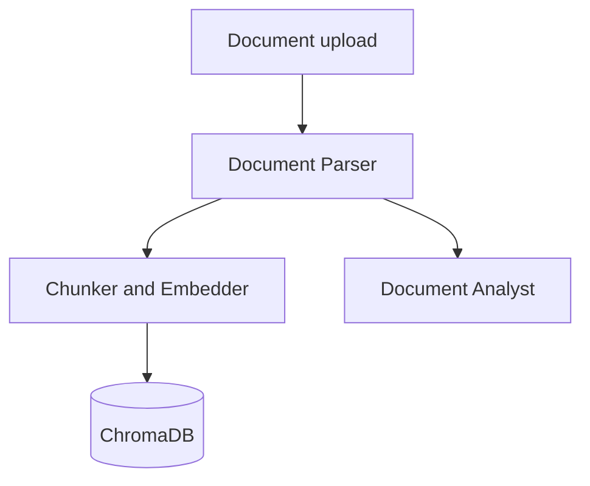
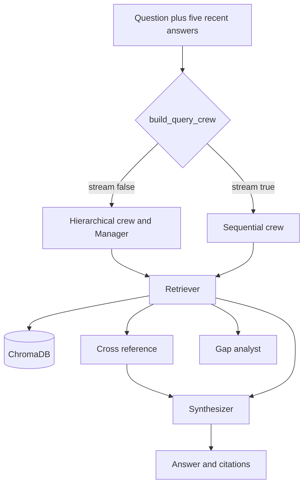
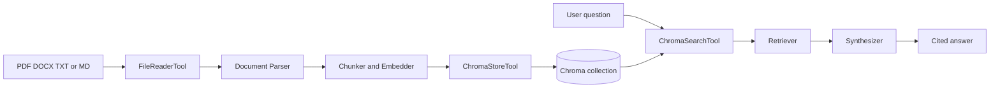

# DocuCrew — Backend

[](https://github.com/raosam23/docucrew-backend/actions/workflows/ci.yml)

[](https://www.python.org/)
[](https://fastapi.tiangolo.com/)
[](https://docs.crewai.com/)
[](https://platform.openai.com/)
[](https://www.postgresql.org/)
[](https://sqlmodel.tiangolo.com/)
[](https://www.trychroma.com/)
[](https://docs.pydantic.dev/)
[](https://www.docker.com/)

[](https://docs.astral.sh/uv/)
[](https://docs.astral.sh/ruff/)
[](https://docs.pytest.org/)

FastAPI backend for [DocuCrew](https://github.com/raosam23/docucrew-frontend), a multi-document workspace. A user registers, keeps documents in collections, and asks questions in plain text. An ingestion crew reads each file and stores chunks in ChromaDB. A query crew retrieves those chunks and returns a cited answer, either as JSON or as a Server-Sent Event stream.

The Next.js client lives in [raosam23/docucrew-frontend](https://github.com/raosam23/docucrew-frontend). Local Docker Compose for the two apps lives in [raosam23/docucrew-infra](https://github.com/raosam23/docucrew-infra). Postgres is external (Neon in the infra repo). This image does not start a database.

## Status

Auth, collections, upload, and both query modes are implemented and wired. Upload waits for the ingestion crew, then a question can be answered once every document in the collection is `ready`.

A few declared pieces are not connected:

- `REDIS_URL` is unused. Logout deletes the `access_token` cookie and does not blacklist the JWT.
- `EMBEDDING_MODEL` is unused. `add_chunks` does not pass vectors. ChromaDB embeds with its default embedding function on add and query.
- The document tagger runs during ingestion, and a gap analyst runs during query. Neither result is saved or returned. `chunk_count` stays null.
- `app/services/collection_service.py` is empty. Collection rules live in the route handlers.
- `app/crews/query/tasks.py` is an older task graph. `build_query_crew` builds its own tasks and does not import that module.

## Features

- Register, login, logout, and current-user. Passwords are bcrypt hashes. Login sets an httpOnly `access_token` cookie. Routes do not read `Authorization: Bearer`.
- Collections per user. Each row stores a Chroma name, `col_{collection_id}`. Deleting a collection deletes that Chroma collection.
- Multi-file upload for `.pdf`, `.docx`, `.txt`, and `.md`, up to 10MB each. The ingestion crew runs inside the request.
- JSON query (`POST .../query`) from a hierarchical crew, and a streaming query (`POST .../query/stream`) from a sequential crew. The chat client uses the stream.
- Query history stored in Postgres. The crews see the five newest question/answer pairs. The stream truncates each earlier answer to 500 characters.
- Alembic migrations and a Docker image that starts the API.

## Architecture

Ingestion is a sequential CrewAI process. The chunk and tag tasks both take the parser task as context. Because the process is sequential, tagging still runs after chunking.



| Agent | Tool | What the task asks for |
| --- | --- | --- |
| Document Parser | `FileReaderTool` | Plain text for each uploaded path |
| Chunker and Embedder | `ChromaStoreTool` | Chunks written into the collection named `{collection_id}` |
| Document Analyst | none | Domain, document type, and topics. The return value is not stored |

Query has two builds of the same four agents.



| Agent | Tools | Returned to the client |
| --- | --- | --- |
| Retriever | `ChromaSearchTool` | No. Its chunks are context for the later tasks |
| Cross reference | none | No. Context for the synthesizer |
| Synthesizer | Tavily on the JSON crew, no tools on the stream crew | Yes. This is the only task the handlers read |
| Gap analyst | `ChromaSearchTool` and Tavily | No. The task runs and the handler ignores it |
| Manager | none, delegation on | Only the JSON crew. There is no manager when `stream=True` |

The JSON synthesizer must return a `QueryAnswer` object (`answer` and `citations`). The stream synthesizer writes plain text, then the marker `__CITATIONS_JSON__` and a JSON array. The route forwards only `SynthesizerAgent` text tokens and parses that trailer into citations.

### RAG pipeline

Chunking is not a local splitter. The chunker agent is expected to call `ChromaStoreTool`, and that tool calls `add_chunks`. Retrieval is `ChromaSearchTool` calling `search`. Embeddings are whatever ChromaDB's default embedding function produces. The OpenAI key is for the chat agents, not for `EMBEDDING_MODEL`.



Tavily is a fallback tool on the JSON synthesizer and on the gap analyst. The streaming synthesizer does not get it, so tool-call chunks are not mixed into the token stream.

## Tech stack

| Layer | Choice |
| --- | --- |
| API | FastAPI, Uvicorn |
| Agents | CrewAI, crewai-tools, Tavily |
| Chat model | OpenAI, `OPENAI_MODEL`, default `gpt-4o-mini` |
| Vectors | ChromaDB persistent client, cosine space |
| Database | PostgreSQL through asyncpg, `ssl=require` |
| ORM and migrations | SQLModel, SQLAlchemy asyncio, Alembic |
| Auth | python-jose (JWT) and bcrypt, cookie `access_token` |
| Documents | pypdf, python-docx |
| Packaging | uv, Python 3.12+ |

## Project structure

```
app/
├── main.py                 # FastAPI app, CORS, /api, GET /health
├── api/
│   ├── router.py           # Mounts the route modules
│   └── routes/             # Auth, collections, documents, query
├── core/                   # Settings and cookie JWT helpers
├── db/                     # Async engine and session
├── models/                 # SQLModel tables
├── schemas/                # Pydantic request and response models
├── services/
│   ├── file_service.py     # PDF, DOCX, TXT, MD text
│   ├── chroma_service.py   # Create, add, search, delete
│   └── collection_service.py  # Empty
└── crews/
    ├── tools.py            # FileReader, ChromaStore, ChromaSearch
    ├── ingestion/          # Sequential parse, chunk, tag
    └── query/              # build_query_crew(stream=...)
alembic/                    # Migrations
tests/                      # Pytest suite, no network and no real keys
.github/workflows/          # CI
```

Uploaded files are written under `uploads/` and Chroma's files under `CHROMA_PERSIST_DIR` (default `./chroma_data`). Both are gitignored.

## Setup

Requirements: Python 3.12+, [uv](https://docs.astral.sh/uv/getting-started/installation/), PostgreSQL that accepts SSL, an OpenAI API key, and a Tavily API key. The app reads `TAVILY_API_KEY` while importing the query agents, so the process will not start without it.

```bash
git clone https://github.com/raosam23/docucrew-backend.git
cd docucrew-backend
uv sync
cp .env.example .env
```

Fill in `DATABASE_URL`, `SECRET_KEY`, `OPENAI_API_KEY`, and `TAVILY_API_KEY`. Then apply migrations and start the API:

```bash
uv run alembic upgrade head
uv run uvicorn app.main:app --reload
```

| URL | Purpose |
| --- | --- |
| http://localhost:8000 | API |
| http://localhost:8000/docs | Swagger UI |
| http://localhost:8000/health | Health check |

CORS allows `http://localhost:3000` by default, with credentials, so the browser can send the cookie. `ALLOWED_ORIGINS` must list origins explicitly.

The Docker image installs production dependencies and starts Uvicorn. It does not run Alembic. Apply migrations first, or use [docucrew-infra](https://github.com/raosam23/docucrew-infra), whose Compose file runs migrations and then the API.

```bash
docker build -t docucrew-backend .
docker run --env-file .env -p 8000:8000 docucrew-backend
```

### Environment variables

| Variable | Required | Default | Purpose |
| --- | --- | --- | --- |
| `APP_NAME` | No | `DocuCrew` | Settings name |
| `APP_ENV` | Yes | | Environment name |
| `DEBUG` | Yes | | SQLAlchemy SQL echo and FastAPI debug |
| `DATABASE_URL` | Yes | | Async URL, `postgresql+asyncpg://...`. The engine also sets `ssl=require` |
| `SECRET_KEY` | Yes | | JWT signing secret |
| `ALGORITHM` | No | `HS256` | JWT algorithm |
| `ACCESS_TOKEN_EXPIRE_MINUTES` | No | `60` | Cookie `Max-Age` and JWT lifetime |
| `SALT_ROUNDS` | No | `12` | bcrypt cost |
| `OPENAI_API_KEY` | Yes | | Key for the CrewAI agents |
| `OPENAI_MODEL` | No | `gpt-4o-mini` | Chat model passed to each agent |
| `EMBEDDING_MODEL` | No | `text-embedding-3-small` | Stored on settings. The Chroma service does not read it |
| `CHROMA_PERSIST_DIR` | No | `./chroma_data` | Chroma persistent path |
| `ALLOWED_ORIGINS` | No | `["http://localhost:3000"]` | JSON list of CORS origins |
| `REDIS_URL` | No | `redis://localhost:6379` | Stored on settings. Unused |
| `TAVILY_API_KEY` | Yes | | Web search tool. Required at import |

## API

REST routes are under `/api`. Protected routes require the `access_token` cookie set by login. A missing or invalid cookie returns `401`. Logout, register, login, and `GET /health` are public.

The cookie is httpOnly and `SameSite=lax`. `secure` is false so local HTTP can send it.

### Health

| Method | Path | Auth | Description |
| --- | --- | --- | --- |
| `GET` | `/health` | No | Returns `{"status": "ok"}` |

### Authentication — `/api/auth`

| Method | Path | Auth | Description |
| --- | --- | --- | --- |
| `POST` | `/api/auth/register` | No | Body `{email, password, name?}`. `201` and the user. `400` if the email exists |
| `POST` | `/api/auth/login` | No | Body `{email, password}`. Sets `access_token` and returns the user. `401` for a bad email or password |
| `POST` | `/api/auth/logout` | No | Deletes the cookie. Returns `{"message": "Logged out successfully"}` |
| `GET` | `/api/auth/me` | Yes | Current user |

The user payload is `{id, email, name, created_at}`. The password hash is not returned.

### Collections — `/api/collections`

| Method | Path | Auth | Description |
| --- | --- | --- | --- |
| `POST` | `/api/collections/` | Yes | Body `{name, description?}`. `chroma_collection_id` is `col_{id}` |
| `GET` | `/api/collections/` | Yes | Collections for the current user |
| `GET` | `/api/collections/{collection_id}` | Yes | One collection. `404` if it is missing or owned by someone else |
| `DELETE` | `/api/collections/{collection_id}` | Yes | Deletes the row and the Chroma collection. `204` |

### Documents — `/api/collections/{collection_id}/documents`

| Method | Path | Auth | Description |
| --- | --- | --- | --- |
| `POST` | `/api/collections/{collection_id}/documents/` | Yes | Multipart field `files`, repeated. Runs the ingestion crew, then returns the documents |
| `GET` | `/api/collections/{collection_id}/documents` | Yes | Documents in the collection |
| `DELETE` | `/api/collections/{collection_id}/documents/{document_id}` | Yes | Deletes the file, Chroma chunks for that `doc_id`, and the row. `400` while `processing` |

An unknown extension returns `400`. A file larger than 10MB returns `400`. A missing collection returns `404`. If the crew raises, the uploaded documents are saved with status `failed` and `error_message` set. A successful crew run sets status `ready`. `chunk_count` is not filled in.

Document status is `pending`, `processing`, `ready`, or `failed`. File type is `pdf`, `docx`, `txt`, or `md`.

### Query — `/api/collections/{collection_id}`

| Method | Path | Auth | Description |
| --- | --- | --- | --- |
| `POST` | `/api/collections/{collection_id}/query` | Yes | Body `{question}`. Hierarchical crew. Returns `{answer, citations, query_id}` |
| `POST` | `/api/collections/{collection_id}/query/stream` | Yes | Same body. `text/event-stream` |
| `GET` | `/api/collections/{collection_id}/history` | Yes | Saved questions for the collection |

Both query routes return `400` if any document is not `ready`. They do not require the collection to contain a document. A missing collection returns `404`. If the JSON synthesizer does not produce a `QueryAnswer`, the route returns `500` with `Failed to synthesize answer`.

A citation is `{filename, chunk_index, relevance_score}`.

#### Stream events

| Event | Payload | When |
| --- | --- | --- |
| `status` | `{"message": "started"}` | The stream opened |
| `token` | `{"content": "..."}` | A piece of synthesizer text |
| `done` | `{query_id, answer, citations, created_at}` | History was saved. This payload is the answer to keep |
| `error` | `{"message": "..."}` | The crew or the save failed after the stream opened |

Auth failures, a missing collection, and documents that are not `ready` are normal JSON errors. They are not SSE events.

## Testing

The suite is pytest. It does not need Postgres, Chroma, OpenAI, Tavily, or any other network service. `tests/bootstrap.py` sets dummy environment variables when they are not already present, and CI sets the same placeholders. CrewAI telemetry is disabled in that bootstrap.

```bash
uv sync
uv run pytest
uv run pytest --cov=app --cov-report=term-missing
uv run ruff check . --exclude alembic/ --select=E,F --ignore=E501,F821
uv run pyright
```

| Area | What is covered |
| --- | --- |
| `tests/test_security.py` | bcrypt hashes and JWT create, expiry, tamper, missing subject, and unknown user |
| `tests/test_schemas.py` | Auth, collection, document, and query validation |
| `tests/test_config_and_database.py` | Settings defaults and the session / `init_db` helpers |
| `tests/test_file_service.py` | TXT, Markdown, DOCX, PDF, and unsupported types |
| `tests/test_chroma_service.py` | Add, search, and delete against a fake Chroma client |
| `tests/test_crew_tools.py` | File reader, store, and search tools |
| `tests/test_ingestion_crew.py` | Sequential agents, tools, and task context |
| `tests/test_query_crew.py` | Hierarchical and streaming crews, plus the legacy task module |
| `tests/test_auth_routes.py` | Register, login cookie, logout, `/me`, and `401` on protected routes |
| `tests/test_collection_routes.py` | Create, list, get, delete |
| `tests/test_document_routes.py` | Upload, ingestion failure, type and size checks, list, delete |
| `tests/test_query_routes.py` | JSON query, history, documents that are not ready |
| `tests/test_query_stream.py` | SSE parsing, citation trailers, and stream errors |
| `tests/test_main.py` | `GET /health` and CORS |

Mocking:

| Dependency | How |
| --- | --- |
| Database | `AsyncMock` session. `add` stays synchronous, matching SQLAlchemy |
| FastAPI dependencies | `app.dependency_overrides` for `get_session` and `get_current_user` |
| CrewAI / OpenAI / Tavily | `kickoff` is a `MagicMock`. Crew tests only inspect agents, tasks, and tools |
| Chroma and embeddings | The Chroma client is replaced. Search and add never download a model |
| Files | Upload tests run in a temporary working directory. PDF pages are a scripted `PdfReader` |
| Stream history | `async_session_maker` returns the mock session. `save_query_history` still runs |

## CI

`.github/workflows/ci.yml` runs on pushes and pull requests to `main`. Lint, type checking, and tests are separate jobs, so a failure in one is visible on its own. Each job installs dependencies with `uv sync --frozen` (the dev group is included by default). Production Docker still uses `uv sync --frozen --no-dev`.

| Job | What it runs |
| --- | --- |
| Lint | `ruff check` for pycodestyle and pyflakes (`E501` and `F821` ignored, Alembic excluded). `ruff format --check` is allowed to fail without failing the job. |
| Type Check | `pyright`, allowed to fail without failing the job. |
| Test | `pytest` with coverage of `app`. The job fails if coverage drops below 95%. |
